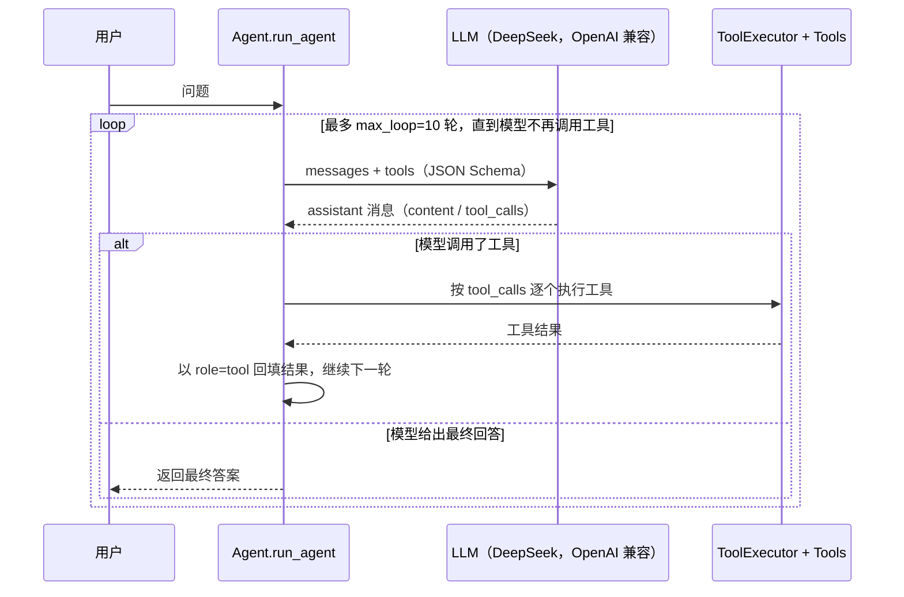

# Tool-Calling Agent：手写一个会调用工具的 AI Agent

一个**不依赖任何 Agent 框架**的 Python 智能体实现：基于 OpenAI 兼容接口的**原生 Function Calling**，由大模型自主决定调用哪个工具，Agent 循环执行工具并把结果回填给模型，直到得到最终答案。

项目内置 4 个可扩展的工具（安全计算器 / 当前时间 / 笔记保存 / 联网搜索），并用一个**工具注册表**统一管理工具的校验、JSON Schema 投影、查询与执行。

> 原代码是个人学习仓库 Hello_Agent 中的 `Project/` 模块，本仓库整理为独立可运行的项目。

## 项目亮点

- **原生 Function Calling**：不使用 LangChain 等框架，直接调用模型 `tool_calls`，完整实现 Agent 主循环。
- **工具注册表设计**：每个工具用 `tool_detail` 声明「名称 / 描述 / JSON Schema / 执行函数」，`ToolExecutor` 负责注册校验与投影，新增工具只需加一个文件。
- **AST 安全计算器**：用 `ast.NodeVisitor` 白名单解析并计算表达式，不使用 `eval`，从语法层面拒绝属性访问、赋值等危险操作。
- **多模型兼容**：基于 OpenAI 兼容协议，改 `base_url` + `model` 即可在 DeepSeek / 通义千问等模型间切换。
- **工程化细节**：循环轮数上限、模型/工具异常收口、流式与非流式输出、`.env` 密钥隔离。

## 架构



## 目录结构

```
.
├── Agent.py            # Agent 主循环：调用模型、执行工具、回填结果、终止判断
├── LLM_client.py       # LLM 客户端封装（OpenAI 兼容，支持流式输出）
├── ToolExecutor.py     # 工具注册表：注册校验 / 查询 / Schema 投影 / 执行
├── Prompt.py           # 系统提示词（角色、约束、可用工具）
├── Tools/
│   ├── calculator.py   # 安全计算器：AST 白名单求值
│   ├── get_time.py     # 获取当前日期时间
│   ├── save_note.py    # 将一段文本追加保存到本地文件
│   └── search.py       # 调用搜索 API 获取最新信息
├── requirements.txt
├── .env.example
└── README.md
```

## 内置工具

| 工具 | 入参 | 能力 | 实现要点 |
|---|---|---|---|
| `calculator` | `expression: str` | 计算数学表达式 | `ast` 白名单：四则运算、整除、取模、乘方、比较，以及 `abs/sqrt/sin/cos/tan/log/exp/ceil/floor` 等函数和 `pi/e/tau` 常量；拒绝 `eval` 类危险语法 |
| `get_time` | 无 | 返回当前日期、时间、星期 | 直接读取系统时间，禁止模型编造时间 |
| `save_note` | `note: str` | 把文本追加到 `Tools/save_note.txt` | 参数类型/空值校验，追加写入 |
| `search` | `details: str` | 联网搜索最新信息 | 调用搜索 API，过滤后返回前 6 条结果（标题/摘要/日期/链接） |

## 快速开始

环境要求：**Python 3.10+**。

```bash
git clone <本仓库地址>
cd <仓库目录>

python -m venv .venv
# Windows
.venv\Scripts\activate
# macOS / Linux
source .venv/bin/activate

pip install -r requirements.txt
```

配置密钥：

```bash
cp .env.example .env    # Windows: copy .env.example .env
# 编辑 .env，填入 DeepSeek API Key（搜索工具需要另配百度搜索 API）
```

运行：

```bash
python Agent.py
```

`Agent.py` 的 `__main__` 会依次测试三个问题：模型对比类问题（需要搜索）、数学计算 + 当前时间（计算器 + 时间工具）、以及「刚才用了哪些工具」（考察上下文）。运行日志会打印每一轮的工具调用与结果。

## 环境变量

项目通过 `python-dotenv` 从 `.env` 读取配置，**真实密钥不要提交到仓库**。

| 变量名 | 必填 | 用途 |
|---|---|---|
| `DeepSeek_API_KEY` | 是 | DeepSeek API Key |
| `DeepSeek_MODEL_URL` | 是 | OpenAI 兼容接口地址，如 `https://api.deepseek.com` |
| `DeepSeek_MODEL_1` | 是 | 使用的模型名称 |
| `BAIDU_API_KEY` | 搜索工具需要 | 搜索 API Key |
| `BAIDU_URL` | 搜索工具需要 | 搜索 API 端点 |

## 实现说明

- **主循环**（`Agent.run_agent`）：构造 `messages` 与 `tools`，调用模型；若返回 `tool_calls`，逐个执行工具并以 `role=tool` + `tool_call_id` 回填，继续下一轮；若没有 `tool_calls`，直接返回最终回答；`max_loop` 防止无限循环。
- **工具注册表**（`ToolExecutor.tool_add`）：校验工具名/描述/参数/函数可调用/是否重名，全部通过才注册；`get_tool_schemas()` 把注册表投影成模型需要的 `tools` JSON Schema。
- **安全计算器**（`Tools/calculator.py`）：`ast.parse(mode="eval")` 后遍历语法树，仅放行白名单节点与函数；`generic_visit` 兜底拒绝任何未授权语法，避免 `eval` 注入。
- **异常收口**：LLM 调用异常、工具缺失、参数错误都会转成可读错误信息返回给模型，而不是让程序崩溃。

## Roadmap

- [ ] 工具注册表改为装饰器注册，支持自动生成 Schema
- [ ] 增加会话记忆与多轮对话
- [ ] 增加单元测试与 Mock LLM
- [ ] 支持更多工具（文件读写、HTTP 请求、代码执行沙箱）

## 说明

- 本项目为个人学习实践，部分内容参考《Hello-Agents》教程；代码中的中文注释是学习过程的记录。
- 仓库不包含任何 API Key 或隐私信息；所有密钥通过 `.env` 在本地配置。
- 外部搜索 API 的可用性与计费由服务商决定，本项目仅用于学习与演示。
